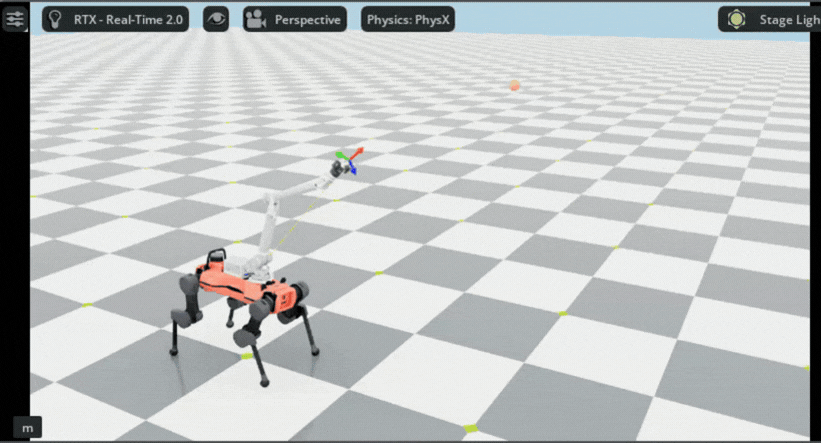
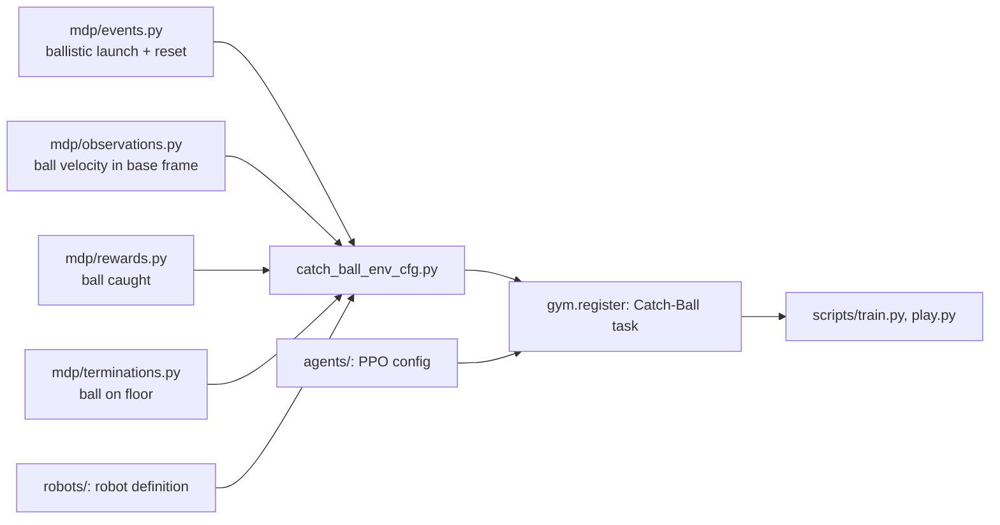

# Dynamic ball catching with a legged manipulator (ANYmal D + DynaArm + Robotiq 2F-85)

**Problem.** Intercept a ball thrown toward the robot. A single PPO policy controls all 19 joints (12 legs, 6 arm, 1 gripper), so the body can help the arm reach the ball.

Isaac Lab 3.0 / Isaac Sim 6.1, PhysX. PPO (RSL-RL), 512 parallel environments, 3000 iterations, 50 Hz control. The ball is a 7.5 cm, 100 g sphere.

## MDP

| | Details |
|---|---|
| Observations (72) | base linear and angular velocity (6), projected gravity (3), positions and velocities of 19 joints (38), ball position (3) and velocity (3) in the base frame, last action (19) |
| Actions (19) | 12 leg joint position targets, 6 arm joint position targets, binary gripper |
| Rewards | gripper-to-ball distance at two scales (+0.5, +1.0); caught: ball within 10 cm, gripper closed, ball in the air and slow (+15); alive (+0.2); flat orientation (-1.0); robot fell (-20); action rate (-0.005); leg torques (-1e-5) |
| Terminations | time out (4 s), ball touches the floor, bad base orientation, base too low |
| Domain randomization | ball launch point (2-3 m ahead, 1.2-1.9 m high), target point within arm reach, flight time 0.8-1.1 s (ballistic launch), initial arm pose (+-0.05 rad) |

## Architecture

## Results

- Catch reward reached 11.8 of a possible 15 after 3000 iterations (training log).
- Video: robot catching a thrown ball.

> *Code is confidential (USP Center for Robotics - CROB) and cannot be shared. Available upon request with lab approval.*
